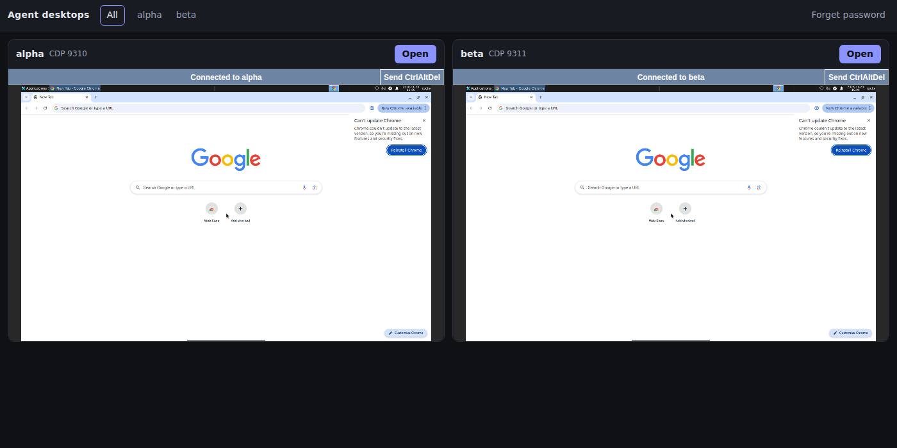

# agent-desktops

One real, visible Chrome per project for AI coding agents. Each one runs on its own Linux desktop with its own profile, and one web page shows all of them live.



## Why I built it

I run several Claude Code sessions at once, one per project. They all drove the same headless Chrome on a test VM, and they kept stepping on each other. One session would grab the tab another was using. One would log in as a test user and log the other one out. My own browser-check suite cleared cookies at the start of a sign-up test, which signed out every other session on the box. Tests failed for reasons that had nothing to do with the code, and I couldn't see any of it happening.

Now each project gets:

- a virtual desktop (TigerVNC + XFCE)
- a real Google Chrome with its own profile, so logins survive restarts
- a DevTools port on localhost for the agent to drive
- a noVNC web view, so I can watch it or take over the mouse and keyboard

The portal page shows every desktop as a live, view-only preview. Click one and you're using it full size. That's how I log into things myself (no passwords handed to an agent), close a stuck dialog, or just see what a session is doing.

## Install

Tested on Ubuntu 24.04 (amd64). Run it on a machine you use for testing, not your daily desktop.

```bash
git clone https://github.com/twogunrock/agent-desktops.git
cd agent-desktops
sudo ./agent-desktops setup          # packages, Chrome if missing, services, portal
sudo agent-desktops add myproject    # a desktop + Chrome + web view
sudo cat ~/.vnc/agent-desktops.password.txt
```

Then open `http://<machine>:6100/`, type the password once, and pick a desktop. The password is eight characters with no look-alikes (no 0/O, 1/l/I), because you will end up typing it from a screen at some point.

```
agent-desktops list               # names, ports, status
agent-desktops port myproject     # the DevTools port, for scripts
sudo agent-desktops remove myproject
```

`remove` keeps the browser profile in `~/.cache/agent-chrome-<name>`, so adding the name back brings its logins back.

## Pointing an agent at its browser

Ports come from the desktop's display number N: DevTools on `9300+N`, web view on `6100+N`, VNC on `5900+N`. `agent-desktops port <name>` prints the DevTools one. DevTools and VNC only listen on localhost.

Puppeteer, on the same machine:

```js
import puppeteer from 'puppeteer-core';
const browser = await puppeteer.connect({ browserURL: 'http://127.0.0.1:9310' });
const page = await browser.newPage();
await page.goto('https://example.com');
```

Playwright (Python) should connect the same way, `p.chromium.connect_over_cdp("http://127.0.0.1:9310")`, though I've only tested Puppeteer.

Google's Chrome DevTools MCP server can attach to it with `--browser-url`:

```json
{ "mcpServers": { "chrome-devtools": {
    "command": "npx",
    "args": ["chrome-devtools-mcp@latest", "--browser-url=http://127.0.0.1:9310"] } } }
```

If the agent runs on another machine, tunnel the port first: `ssh -N -L 9310:127.0.0.1:9310 you@test-box`.

Then put one line in each project's `CLAUDE.md` (or whatever your agent reads): *"Browser work uses the `myproject` desktop, DevTools port 9310. Never use another project's."* Without it, a session reaches for whichever browser it used last.

## Things I learned the hard way

- **Chrome lists its own UI as pages.** In a visible Chrome, `/json/list` includes `chrome://omnibox-popup.top-chrome/` targets. Grab the first "page" and you may be driving the address-bar popup. My first test loaded a site into it and nothing appeared on screen. Open your own tab with `/json/new` and close it when you're done.
- **Two Chromes can share a DevTools port without an error.** One takes IPv4 and the other IPv6, and your commands go to whichever `localhost` resolves to. A leftover Chrome from a week earlier was sitting on the port I picked. That's why ports here come from the display number and `add` checks they're free.
- **Background tabs get throttled.** A tab that isn't in front runs its timers slowly, which turns into flaky checks. The Chrome service turns that off.
- **Clearing cookies is browser-wide.** `Network.clearBrowserCookies` in one tab signs out every other tab. With one profile per project, it only hurts that project.

## Security

Read this before you put it anywhere but a private network.

- The web views are plain HTTP, and VNC passwords are eight characters with old crypto. Keep the machine on a LAN or VPN you trust, or reach it over an SSH tunnel.
- DevTools ports are localhost-only. Anyone with a shell on the machine can still drive those browsers and read their cookies.
- Profiles hold real logins. Treat the machine like the accounts you sign into on it.
- The portal keeps the VNC password in your browser's localStorage. Nothing secret sits on the server beyond the VNC password file.

## Why not an "AI browser"?

I looked at Cloudflare's Kitesurf, Obscura, BrowserOS and Nanobrowser before building this. They're built for agents reading lots of pages cheaply, and for that they're probably better. I'm testing my own apps, so I need the browser my users have (real Chrome), logins that stay put, and a way to watch. None of them gave me all three.

## Files

| Path | What it is |
|---|---|
| `agent-desktops` | the whole tool (bash): setup, add, remove, list, port |
| `systemd/*.service.in` | unit templates; `setup` fills in the user and paths |
| `portal/index.html` | the portal page; reads `desktops.json`, which `add`/`remove` keep current |

Settings for anyone running two copies side by side: `PREFIX` (default `agent`) names the units and folders, `AGENT_USER` picks who owns the desktops, and `PORTAL_PORT` (default 6100) moves the portal.

## License

MIT. Built with [Claude Code](https://claude.com/claude-code).
